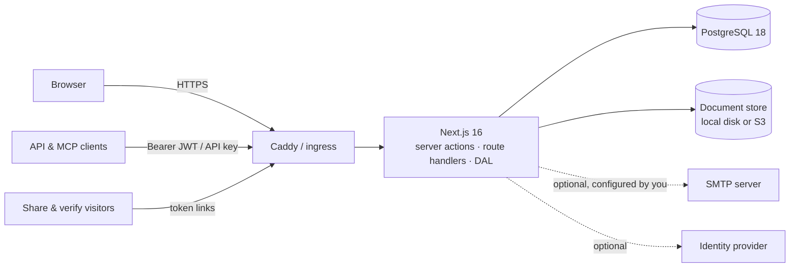

# okinvo

Self-hosted invoicing for an independent professional or a small business: issuer profiles
(individual and company), clients, a service and product catalogue, immutable numbered invoices
with PDF, DOCX and QR verification, a payments ledger with TDS, credit notes, e-mail sending,
share links, CSV/XLSX exports and accountant hand-offs — on your own Docker host or Kubernetes
cluster, with no outbound dependencies.

[](https://github.com/deveshgupta30/okinvo/actions/workflows/ci.yml)
[](https://github.com/deveshgupta30/okinvo/actions/workflows/security.yml)


## What okinvo is

A single Next.js application in front of PostgreSQL and a document store, built for one
freelancer or contractor who bills as an individual, through their own company, or both. It
covers the whole lifecycle — client and catalogue → invoice builder with live preview → issue
(immutable PDF + verification QR) → send → payments → credit notes → exports — and nothing else.
There is no SaaS tier, no telemetry and no call home: every font, script and dataset ships in the
image, so an air-gapped instance works unchanged.

## Screenshots

_Screenshots of the dashboard, the builder, a rendered invoice and the share viewer are added
with the documentation site (plan Task 45)._

## Features

- **Issuer profiles** for individuals and companies: tax identifiers (GSTIN, PAN, LUT, UK VAT),
  number formats such as `INV/{FY}/{SEQ:3}`, fiscal-year start, logo, signature, stamp, payment
  methods (encrypted at rest), per-profile document template override.
- **Clients** with tax ids, state (GST place of supply), currency and payment terms;
  **services and products** (SKUs) tagged to the profiles that sell them.
- **Invoice builder** with a live preview that is the same renderer as the PDF: catalogue or ad hoc
  lines, discounts, India GST (CGST/SGST/IGST, exports under LUT, reverse charge), UK VAT and
  plain-rate regimes, expected TDS, display configuration per document, page-count estimate.
- **Issue** allocates a gap-free number inside one transaction, snapshots everything and stores a
  hashed PDF; issued documents never change — fix with void, void-and-reissue or a credit note.
- **Documents**: six templates (ledger, classic, compact, minimal, letterhead, modern), a
  100-family Google font catalogue vendored offline, header bands or letterhead images, A4 and
  Letter, DOCX copies, password-protected PDF copies (AES-256, print-only), the public
  verification page behind every QR.
- **Share links** `/i/<token>` with an optional passphrase gate, expiry, revocation and counts.
- **Payments** ledger (TDS withheld, FX received, bank fees, receipts) driving sent / partially
  paid / paid / overdue statuses; **credit notes** with pro-rata tax apportionment.
- **E-mail** through your own SMTP server from a composer that attaches the stored PDF or DOCX,
  or a hand-off to your mail app; every attempt is logged.
- **Exports**: every register as CSV/XLSX, GST and TDS summaries, the full-data ZIP (encrypted
  columns left out) and the documents ZIP for the accountant.
- **Roles**: owner, editor, viewer; invitations through the allow-list; session revocation;
  audit log of every state change.
- **Privacy and legal**: strictly necessary cookies only, cookie notice, generated cookie policy,
  Terms, Acceptable Use, Privacy Policy, retention schedule, security page and licence notices
  driven by Settings → Legal.
- **Operations**: Settings → Status (`/api/health/status`), backups with a tested restore drill,
  Docker Compose and Kustomize deployments, Trivy-scanned images.

## Architecture



Authorization lives in the data-access layer: every server action and route handler resolves
the signed-in user and the DAL checks the role before touching a row. Money is `Decimal` end to
end, dates are calendar strings at every boundary, every `Json` column has a Zod schema, and
every text field accepts only standard keyboard characters. See `SPEC.md` (what) and
`IMPLEMENTATION_PLAN_v2.md` (how).

## Quick start (Docker Compose)

```bash
cp .env.example .env && scripts/gen-secrets.sh >> .env    # then delete the two placeholder secret lines
# edit: APP_DOMAIN, APP_URL, AUTH_ALLOWED_EMAILS and one AUTH_* provider pair (or AUTH_PASSWORD_SIGNIN=true)
docker compose up -d --build    # migrate → app → caddy (automatic TLS; internal CA for localhost)
```

If something already owns ports 80/443, serve on another port with a local
`compose.override.yml` (auto-applied, keep it out of git):

```yaml
services:
  caddy:
    environment: { APP_DOMAIN: "localhost:8443" }
    ports: !override ["8443:8443"]
```

and set `APP_URL=https://localhost:8443`. Your browser warns once about Caddy's local CA.

**Air-gapped deployment.** The image contains everything it needs (fonts, flags, wordlists,
exchange-rate snapshot, UI components). Build it on a connected machine with
`scripts/release.sh`, move it with `docker save` / `docker load`, and run it where there is no
internet; nothing in the app fetches from the network unless you set `OUTBOUND_ALLOW`. Refresh
vendored resources on the connected machine with `pnpm vendor:update`.

## Development

Requirements: Node 24 LTS (`.node-version`), pnpm 10, Docker Desktop (Postgres and Mailpit
through `compose.dev.yml`).

```bash
pnpm install
cp .env.example .env && scripts/gen-secrets.sh >> .env
pnpm db:up && pnpm db:generate && pnpm db:migrate
pnpm dev                        # http://localhost:3000
```

| Script | Does |
|---|---|
| `pnpm dev` / `build` / `start` | Next.js dev server, production build, production server |
| `pnpm lint` / `typecheck` / `format` / `format:check` | ESLint, `tsc --noEmit`, Prettier |
| `pnpm test` / `test:watch` / `test:e2e` | Vitest (unit + integration against Docker Postgres), Playwright |
| `pnpm db:up` / `db:down` / `db:generate` / `db:migrate` / `db:migrate:dev` / `db:reset` / `db:check` / `db:studio` / `db:seed` | Database lifecycle; `db:check` proves migrations and `schema.prisma` agree |
| `pnpm design:tokens [--check]` / `design:lint` | Generate `src/app/tokens.css` from `DESIGN.md`; forbid colour literals |
| `pnpm fonts:vendor` / `fonts:check` | Vendor the document font catalogue from Fontsource; CI freshness check |
| `pnpm notices` / `notices:check` | Regenerate `THIRD_PARTY_NOTICES.md` |
| `pnpm env:docs` / `env:docs:check` | Regenerate the configuration table below |
| `scripts/restore-drill.sh` | Backup → wipe → restore against a "drill" database (runs in CI) |
| `scripts/release.sh X.Y.Z [--push]` | Build, scan and (optionally) publish the images |

Test matrix: unit (money, tax engine, numbering, status derivation, exports guard, crypto,
templates), integration (DAL against real Postgres, the issue transaction, concurrency),
end-to-end (sign-in → profile/client → build → issue → download → verify → pay → credit note →
export, on desktop Chromium and a Pixel 7 profile). CI runs on the owner's self-hosted runner
when it is online and on GitHub-hosted Ubuntu otherwise.

## Configuration

Every variable the server reads, from `src/lib/env.schema.ts`. Values in `.env` are validated
at boot; a placeholder secret stops the process on purpose.

<!-- env-docs:start -->

| Variable | Type | Default | Required | Notes |
|---|---|---|---|---|
| `NODE_ENV` | development \| test \| production | `development` |  | compose sets production itself |
| `APP_URL` | URL |  | yes | public origin; in production https://invoices.example.com |
| `LOG_LEVEL` | trace \| debug \| info \| warn \| error | `info` |  |  |
| `TRUST_PROXY` | true \| false | `false` |  | compose sets true itself; set true behind any other ingress |
| `DATABASE_URL` | postgres:// URL |  | yes |  |
| `AUTH_SECRET` | string |  | yes |  |
| `AUTH_ALLOWED_EMAILS` | string |  |  | you@example.com,*@yourdomain.com  (required in production) |
| `AUTH_PASSWORD_SIGNIN` | true \| false | `false` |  | email+password (allow-list still applies); e2e/CI and IdP-less owners |
| `AUTH_LINKING_TRUSTED_PROVIDERS` | string | `google,github` |  |  |
| `AUTH_GOOGLE_ID` | string |  |  |  |
| `AUTH_GOOGLE_SECRET` | string |  |  |  |
| `AUTH_GITHUB_ID` | string |  |  |  |
| `AUTH_GITHUB_SECRET` | string |  |  |  |
| `AUTH_KEYCLOAK_ISSUER` | string |  |  |  |
| `AUTH_KEYCLOAK_ID` | string |  |  |  |
| `AUTH_KEYCLOAK_SECRET` | string |  |  |  |
| `AUTH_CASDOOR_ISSUER` | string |  |  |  |
| `AUTH_CASDOOR_ID` | string |  |  |  |
| `AUTH_CASDOOR_SECRET` | string |  |  |  |
| `AUTH_OIDC_ISSUER` | string |  |  |  |
| `AUTH_OIDC_ID` | string |  |  |  |
| `AUTH_OIDC_SECRET` | string |  |  |  |
| `AUTH_OIDC_NAME` | string | `Enterprise SSO` |  |  |
| `FIELD_ENCRYPTION_KEY` | base64 (32 bytes) |  | yes |  |
| `STORAGE_DRIVER` | local \| s3 | `local` |  | local \| s3 |
| `STORAGE_LOCAL_ROOT` | string | `./.data/storage` |  | compose sets /data/storage itself |
| `S3_ENDPOINT` | string |  |  |  |
| `S3_REGION` | string | `us-east-1` |  |  |
| `S3_BUCKET` | string | `okinvo` |  |  |
| `S3_ACCESS_KEY` | string |  |  |  |
| `S3_SECRET_KEY` | string |  |  |  |
| `BACKUP_STATUS_FILE` | string |  |  | `last-backup.json` written by the backup service; Settings → Data shows it when present. |
| `SMTP_HOST` | string |  |  |  |
| `SMTP_PORT` | number | `587` |  |  |
| `SMTP_SECURITY` | starttls \| tls \| none | `starttls` |  | starttls \| tls \| none |
| `SMTP_USER` | string |  |  |  |
| `SMTP_PASSWORD` | string |  |  |  |
| `SMTP_FROM` | string |  |  |  |
| `SMTP_FROM_NAME` | string |  |  |  |
| `SMTP_REPLY_TO` | string |  |  |  |
| `RATE_LIMIT_STORE` | memory \| postgres | `memory` |  | memory \| postgres |
| `OKINVO_BUILD_SHA` | string |  |  | Build provenance baked into the image (docker/Dockerfile ARG → ENV); shown on Settings → Status. |
| `OKINVO_BUILD_DATE` | string |  |  |  |
| `UPLOAD_MAX_IMAGE_MB` | number | `2` |  |  |
| `UPLOAD_MAX_RECEIPT_MB` | number | `10` |  |  |

_45 variables, generated by `pnpm env:docs` from `src/lib/env.schema.ts`._

<!-- env-docs:end -->

Compose-only variables (`compose.yml`, not read by the app): `APP_DOMAIN` (Caddy site address),
`POSTGRES_USER` / `POSTGRES_PASSWORD` / `POSTGRES_DB` (the bundled database; compose derives
`DATABASE_URL`), `BACKUP_CRON` and `BACKUP_RETENTION_DAYS` (the backup service), `OKINVO_VERSION`
(image tag), `BUILD_SHA` / `BUILD_DATE` (build provenance shown on Settings → Status).

## API, SDK and MCP

Create an API key at Settings → API (scoped, shown once) or mint a 15-minute JWT at
`GET /api/auth/token`, then call the versioned API with `Authorization: Bearer <key>`:

```bash
curl -H "Authorization: Bearer $OKINVO_KEY" https://invoices.example.com/api/v1/invoices?limit=20
curl -H "Authorization: Bearer $OKINVO_KEY" -H "Content-Type: application/json" \
  -d '{"issuerProfileId":"…","clientId":"…","issueDate":"2026-10-03","dueDate":"2026-10-18","currency":"INR","taxRegime":"NONE","items":[{"description":"Work","unitType":"HOUR","quantity":"1","unitPrice":"1000","taxRate":"0"}]}' \
  https://invoices.example.com/api/v1/invoices
curl -X POST -H "Authorization: Bearer $OKINVO_KEY" https://invoices.example.com/api/v1/invoices/<id>/issue
curl -H "Authorization: Bearer $OKINVO_KEY" -o invoice.pdf https://invoices.example.com/api/v1/invoices/<id>/pdf
```

Responses are `{ data }` or `{ data: [...], nextCursor }`; errors are `{ error: { code, message,
issues? } }`. There is no delete or update over the API (405). The generated OpenAPI document,
the TypeScript SDK and the MCP server follow in the v1.1 plan's sub-project E.

## Documentation site

A Wiki.js profile with the user guide and screenshots is part of the v1.1 plan (sub-project G).
Until then: `SPEC.md`, `IMPLEMENTATION_PLAN_v2.md`, `DESIGN.md` and `docs/changelog.md`.

## Using okinvo

1. **Sign in.** Only addresses on `AUTH_ALLOWED_EMAILS` or invited from Settings → Users can
   sign in, through an identity provider or, with `AUTH_PASSWORD_SIGNIN=true`, a password. A
   password sign-up is accepted only for an address listed exactly. The first-run wizard asks for
   your country, currency and the first issuer profile.
2. **Issuer profile** (Settings → Profiles): legal name, address, tax ids, base currency,
   fiscal-year start, number formats, logo, signature, stamp, payment methods.
3. **Clients, services and products**, then **build an invoice** (Invoices → New), watch the
   preview, **Issue**.
4. **Send it** from the composer, or **Share** a link with a passphrase; recipients verify the
   document at `/verify/<token>`.
5. **Record payments** and raise **credit notes**; statuses follow from the ledger and due dates.
6. **Exports** from every register and Settings → Data; **Settings → Status** for health.

## Security and disclosure

HTTPS with HSTS, a nonce-based Content Security Policy, same-origin checks on state-changing
requests, HttpOnly sessions, role checks in the DAL, encryption at rest for tax ids, payment
details and credentials, re-encoded uploads, rate limits, an immutable audit log, pinned
dependencies and Trivy scans of the repository, configuration and image. Report a weakness to
the operator contact on `/legal/security` of your instance, or open a private security advisory
on GitHub for the software itself.

## Roles

| Role | Can |
|---|---|
| Owner | Everything: settings, users, legal and template configuration, all exports |
| Editor | Create and issue documents, record payments, send e-mail, create share links, export registers |
| Viewer | Read and download documents and registers |

## Backups

The Compose `backup` service dumps the database and the storage volume nightly
(`BACKUP_CRON`, `BACKUP_RETENTION_DAYS`); Settings → Status and Settings → Data show the last
run. Restore with `docker compose run --rm backup /backup/restore.sh <dump> <storage.tgz>` after
stopping the app. `scripts/restore-drill.sh` proves the procedure in CI.

## License

Apache License 2.0 — see `LICENSE` and `NOTICE`. Bundled third-party works and their licences
are listed in `THIRD_PARTY_NOTICES.md` (`pnpm notices` regenerates it) and on `/legal/licenses`.
