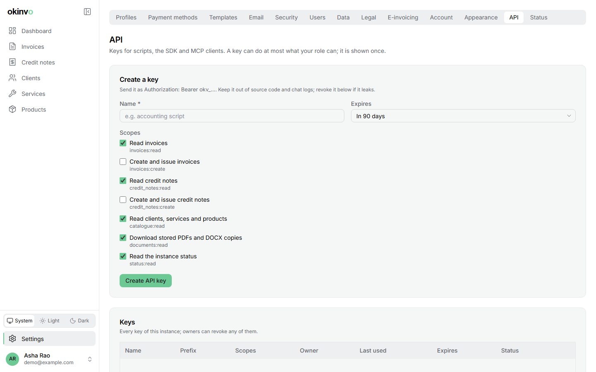

# API and SDK

## API keys



Settings > API creates a key: a name, a subset of scopes and an optional expiry (30, 90 or 365
days). The key (`okv_` plus 43 random characters) is shown once and stored hashed. Scopes:
`invoices:read`, `invoices:create`, `credit_notes:read`, `credit_notes:create`,
`catalogue:read`, `documents:read`, `status:read`. Your role is a ceiling at creation and at
every use: a viewer can hold read scopes only, and a demotion narrows existing keys at once.
Keys are refused when revoked, expired or when their user is deactivated, and are rate-limited
to 120 requests per minute. A 15-minute JWT from `GET /api/auth/token` works too, with the
scopes of your role.

## The REST API

`/api/v1/*` authenticates with `Authorization: Bearer <key>` and every route names the scope
it needs.

```bash
curl -H "Authorization: Bearer $OKINVO_KEY" "https://invoices.example.com/api/v1/invoices?limit=20"
curl -H "Authorization: Bearer $OKINVO_KEY" -H "Content-Type: application/json" \
  -d '{"issuerProfileId":"...","clientId":"...","issueDate":"2026-10-03","dueDate":"2026-10-18","currency":"INR","taxRegime":"INDIA_GST","items":[{"description":"October retainer","unitType":"FIXED","quantity":"1","unitPrice":"50000","taxRate":"18"}]}' \
  https://invoices.example.com/api/v1/invoices
curl -X POST -H "Authorization: Bearer $OKINVO_KEY" https://invoices.example.com/api/v1/invoices/<id>/issue
curl -H "Authorization: Bearer $OKINVO_KEY" -o invoice.pdf https://invoices.example.com/api/v1/invoices/<id>/pdf
```

Routes: invoices (list with the register filters, get, create a draft, issue, pdf, docx,
facturx), credit notes (list, get, create against an issued invoice, issue, pdf, docx, facturx),
clients, profiles (without tax ids or mail defaults), services and products (optionally only
those offered to an issuer), payment methods (names and types only, never details) and status.

Conventions:

- Amounts, quantities and rates are decimal strings (`"1500.00"`); dates are `YYYY-MM-DD`;
  currencies are ISO 4217 codes; text accepts standard keyboard characters only.
- Responses are `{ data }` for one record and `{ data: [...], nextCursor }` for lists (`limit`
  1 to 100, default 50).
- Errors are `{ error: { code, message, issues? } }` with a stable code: `unauthenticated`,
  `insufficient_scope`, `forbidden`, `not_found`, `validation`, `bad_charset`, `conflict`,
  `invariant`, `rate_limited`, `method_not_allowed`.
- There is no delete or update: `DELETE`, `PUT` and `PATCH` answer 405. Corrections go through
  the same void, reissue and credit-note paths as the UI.

## OpenAPI

Every instance serves its OpenAPI 3.1 document at `/api/openapi.json`, generated from the same
validation schemas the server uses and carrying the scope of every operation. The repository
commits a copy at `openapi/okinvo.json`.

## The TypeScript SDK

`sdk/` holds a typed client generated from that document, with no runtime dependency beyond
`fetch`. Copy `sdk/src` into your project:

```ts
import { createClient } from "./sdk/src/client";
import { createInvoice, issueInvoice, listInvoices } from "./sdk/src/sdk.gen";

const client = createClient({
  baseUrl: "https://invoices.example.com/api/v1",
  headers: { Authorization: `Bearer ${process.env.OKINVO_KEY}` },
});
const page = await listInvoices({ client, query: { status: "OVERDUE", limit: 20 } });
```

`sdk/README.md` has the full walkthrough. Agents prefer the MCP server; see
[MCP and skills](mcp-and-skills.md).
