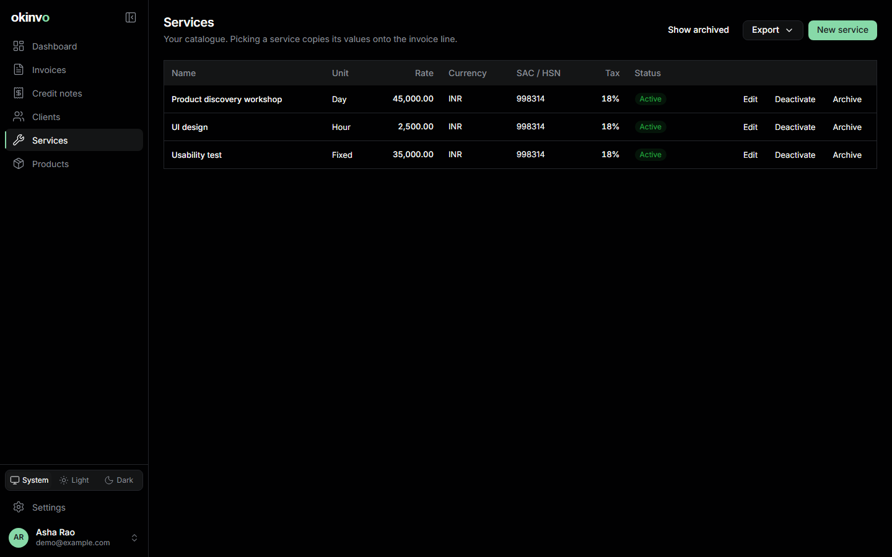
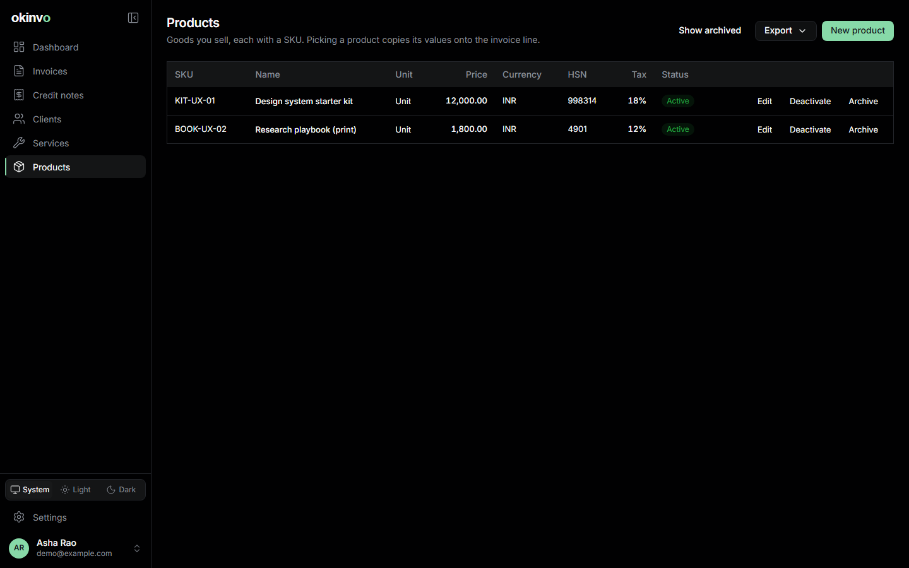

# Services and products

The catalogue saves typing in the builder. Picking an item **copies** its values onto the
invoice line; later edits to the item never touch existing documents.

## Services

Name, description, unit type (`HOUR`, `DAY`, `FIXED`, `MILESTONE`, `UNIT`), default rate,
currency, SAC/HSN code, default tax rate and an active flag.

## Products

Products are goods with a unique **SKU** (letters, digits, `. _ / -`, up to 40 characters), a
name, description, unit (default `UNIT`), unit price, currency, HSN code and default tax rate.
The SKU is snapshotted on the invoice line and prints under the description while the display
config's "show SKU" is on, so the document keeps it even after the product changes or is
archived.

## Profile tags

A service or product can be tagged to one or more issuer profiles. An untagged item is offered
to every profile; a tagged item only to the profiles it names. The builder's picker shows the
items offered to the selected issuer and re-filters when the issuer changes. Tags never affect
lines already on a document.

## Inactive and archived

Inactive items stay in the lists but leave the picker. An item referenced by an invoice line
cannot be deleted, only archived.

Related: [Invoices](invoices.md), [Exports](exports-and-backups.md) (the services and products
datasets).
