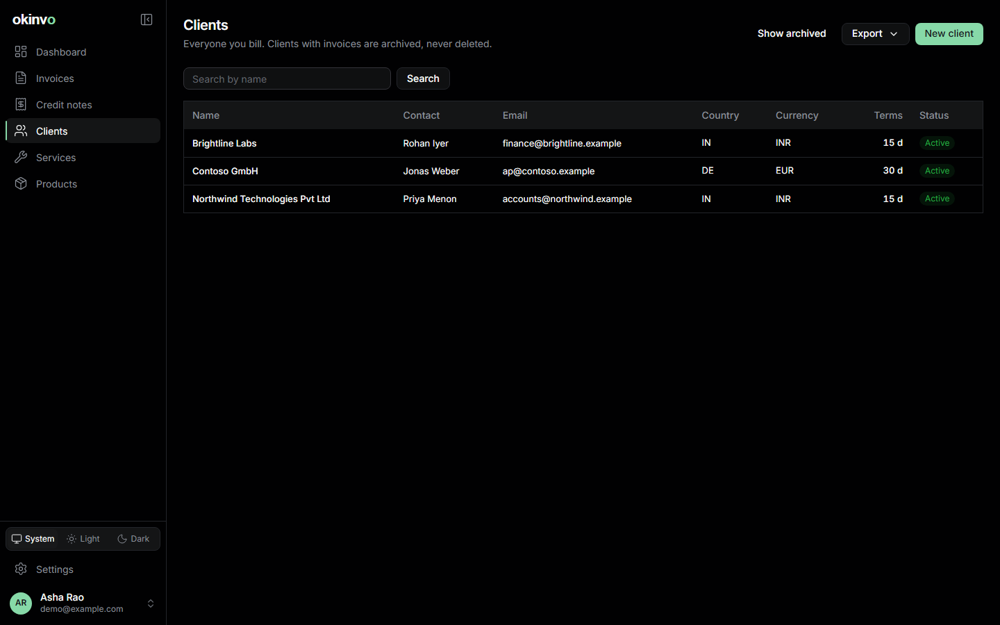
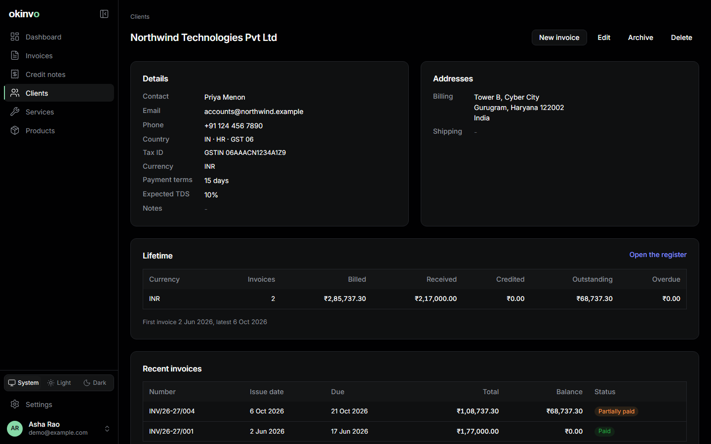

# Clients

A client is the party a document is addressed to. The record carries what the documents and the
tax engine need; everything else is optional.

## Fields

- Display name (organisation or person), contact person, e-mail, phone, notes.
- Billing address, and an optional shipping address.
- Country, state code and GST state code. The GST state code is required when the issuer is
  registered under India GST and the client is in India: it decides between CGST/SGST and IGST
  (the place of supply).
- Tax id and its type: GSTIN, VAT, EIN or other.
- Currency and payment terms (days): the builder prefills the invoice currency and the due date
  from them.
- Default expected TDS rate, for Indian clients that withhold tax at source.
- Preferred document language, when the client should receive documents in another language
  (see [Localisation](localisation.md)).

## The client page

The page shows lifetime billed, received and outstanding amounts per currency, and the client's
invoice history with statuses.

## Archive, never delete

A client referenced by any invoice cannot be deleted, only archived. Archived clients leave the
pickers and the register's default view; their documents are untouched. Unarchive restores them.

Related: [Invoices](invoices.md), [Exports](exports-and-backups.md) (the clients dataset).
