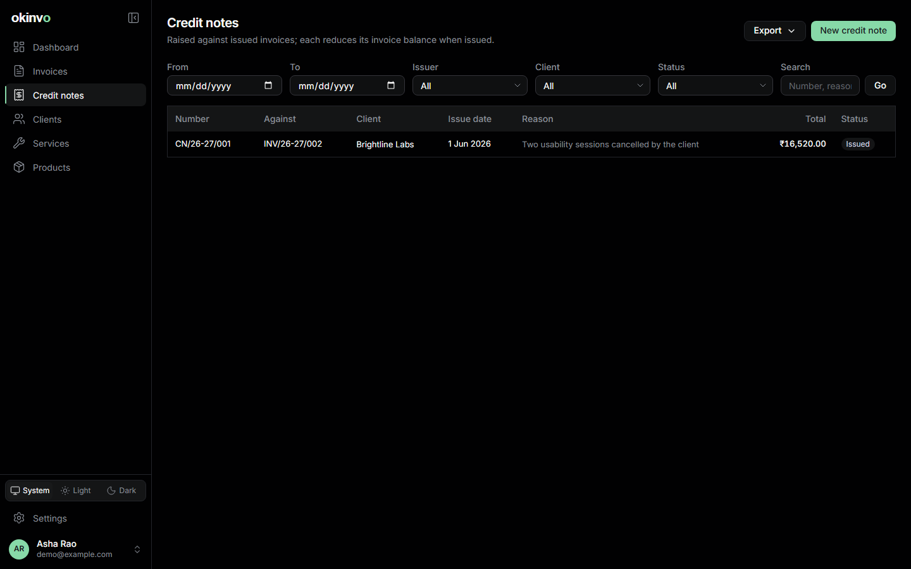
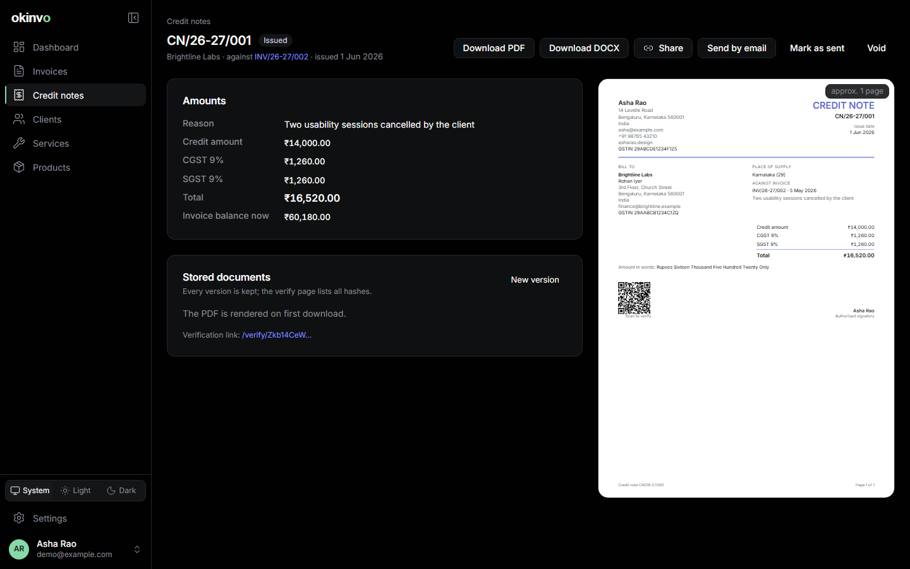

# Credit notes

A credit note corrects an issued invoice without touching it: it reduces the balance due and
prints as its own numbered document.

## Creating one

Credit notes > New, or **Credit note** on the invoice page. Choose the invoice, a reason and
the credit amount **excluding tax**. A picker lets you tick invoice lines (whole or as a
percentage) to compute the amount; it only fills the field. Tax is apportioned pro-rata across
the invoice's tax lines by taxable amount (largest-remainder, so the parts sum exactly), giving
the credit note its own tax lines and total.

Limits at issue time: the credit amount may not exceed the invoice's outstanding taxable balance
and the total may not exceed the outstanding balance.

## Lifecycle

The same as invoices: draft, issued, void. Numbers come from the profile's credit-note format
(`CN/{FY}/{SEQ:3}` by default) in their own gap-free sequence. An issued credit note reduces the
invoice balance; voiding it restores the balance. The credit note copies the invoice's document
language and template snapshot and gets its own PDF, DOCX and verification token.

## Sending and sharing

A credit note can be e-mailed from its own composer, shared by link and, under EN 16931, exported
as CII, UBL and Factur-X like an invoice.

Related: [Invoices](invoices.md), [Payments](payments.md).
