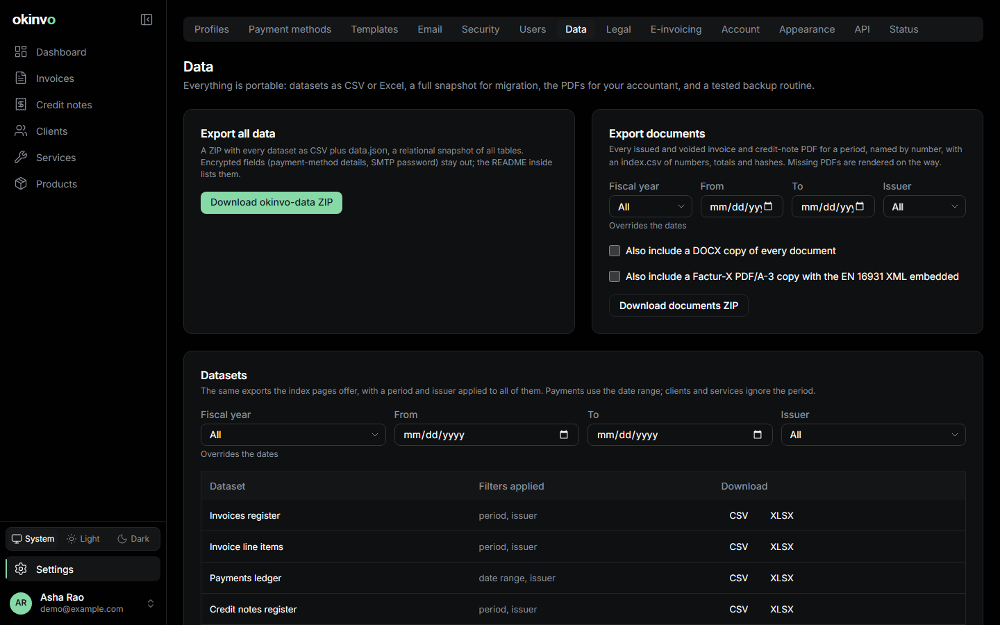

# Exports and backups

## Exports from the registers

Every register (invoices, credit notes, clients, services, products, payments) has an **Export**
control that takes the page's current filters and writes CSV or XLSX. Exports are audited and
rate-limited; viewers can export what they can read.

| Dataset | What it holds |
| --- | --- |
| Invoices register | One row per invoice: numbers, dates, parties, place of supply, every tax component, totals, TDS expected, paid, credited, balance, FX rate, PO reference, sent and void information |
| Invoice line items | One row per line with SAC/HSN, SKU, unit, quantity, rate, tax |
| Payments ledger | Every payment entry with TDS, received amount and currency, FX rate, bank fees, method, reference |
| Credit notes register | Numbers, dates, the invoice credited, amounts, reason |
| Clients, services, products | All fields |
| GST summary | One row per invoice per tax rate, laid out to map onto the GSTR-1 B2B and export tables |
| TDS summary | One row per client and fiscal year: taxable billed, TDS expected, TDS actually deducted |

Format rules: CSV is UTF-8 with a byte-order mark (so Excel opens it correctly), CRLF line ends,
RFC 4180 quoting, ISO dates and plain decimals. XLSX has typed cells, a bold frozen header row,
an autofilter, column widths and a second sheet, `Filters`, recording what was exported and
when. Any cell beginning with `=`, `+`, `-`, `@`, a tab or a carriage return is neutralised
against formula injection.

## Settings > Data



- **Export all data**: a ZIP with every dataset above as CSV plus `data.json`, a full relational
  snapshot for migration. Encrypted columns (tax ids, payment details, credentials) are left out.
- **Export documents**: a ZIP of every issued invoice and credit-note PDF for a fiscal year or
  date range, named by number, grouped by issuer: the accountant hand-off. Options add the DOCX
  copies and, for EN 16931 profiles, the Factur-X PDF/A-3 copies.
- The **last backup** card shows when the nightly backup last ran and what it wrote.

## Backups

On Docker Compose the `backup` service runs nightly (`BACKUP_CRON`, default 02:00 UTC): a
`pg_dump` of the database and a tarball of the document store into the `backups` volume, pruned
after `BACKUP_RETENTION_DAYS`. It writes `last-backup.json`, which Settings > Data and Settings >
Status read. Run one now:

```bash
docker compose exec backup /bin/sh /backup/backup.sh --now
```

Restore after stopping the app:

```bash
docker compose stop app
docker compose run --rm backup /bin/sh /backup/restore.sh /backups/pg/<dump> /backups/storage/<tgz>
docker compose start app
```

`scripts/restore-drill.sh` proves the procedure (backup, wipe, restore against a drill
database) and runs in CI. Kubernetes uses a CronJob with the same scripts; see
[Operations: Kubernetes](operations-kubernetes.md#backups-and-restore).

Copy the `backups` volume off the machine on your own schedule; okinvo never uploads anything.

Related: [Settings](settings.md#data), [Security](security.md).
