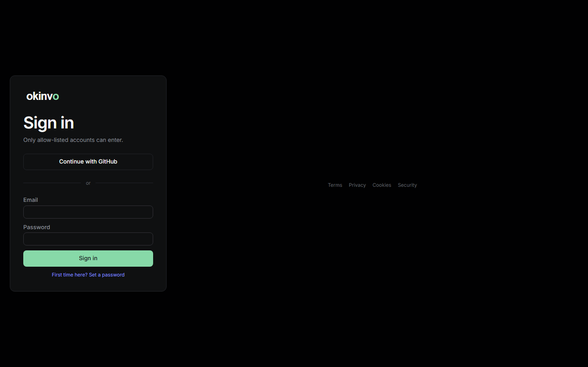
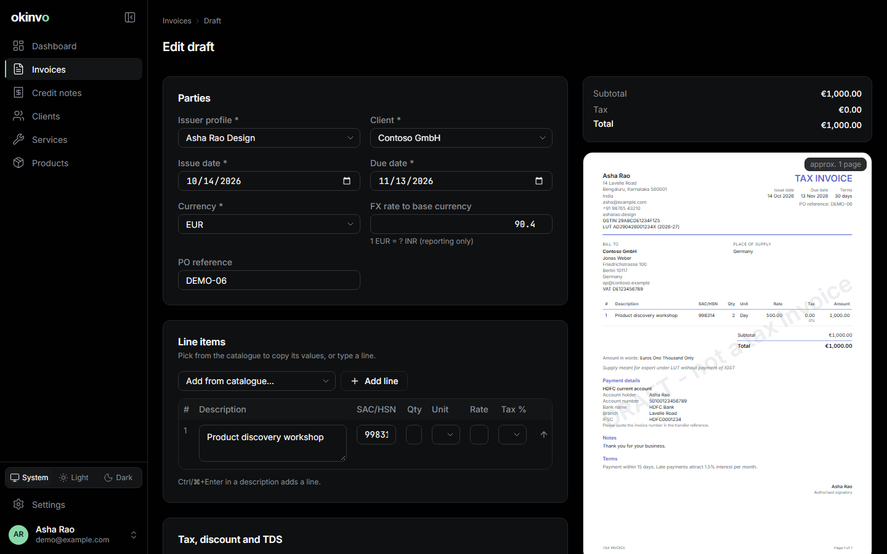

# Getting started

The quickest route from nothing to a first invoice: one machine with Docker, ten minutes.

## 1. Install

```bash
git clone https://github.com/deveshgupta30/okinvo && cd okinvo
cp .env.example .env && scripts/gen-secrets.sh >> .env   # then delete the two placeholder secret lines
```

Open `.env` and set:

- `APP_DOMAIN`: the hostname Caddy serves (it obtains the certificate itself; `localhost` gets
  an internal certificate).
- `APP_URL`: the public origin, `https://` plus that hostname.
- `AUTH_ALLOWED_EMAILS`: the exact addresses allowed to sign in, comma separated. The first
  person to sign in becomes the owner.
- One sign-in method: a provider pair such as `AUTH_GOOGLE_ID` / `AUTH_GOOGLE_SECRET`, or
  `AUTH_PASSWORD_SIGNIN=true` for e-mail and password.

Then:

```bash
docker compose up -d --build
```

Compose starts Postgres, runs the migrations, starts the app, the nightly backup service and
Caddy. `https://<APP_DOMAIN>/api/health/ready` answers `200` once everything is up. If something
else already owns ports 80 and 443, see [Operations: Compose](operations-compose.md#another-port).
To run the published images instead of building, see
[From published images](operations-compose.md#from-published-images).

## 2. Sign in



Open the site. With a provider configured, click it; with password sign-in, choose "First time
here? Set a password" and create the account. Only addresses on the allow-list, or invited later
from Settings, can sign in.

A new account lands in the [first-run wizard](onboarding.md): name, country, currency, how you
invoice, and an optional tax id. The wizard ends on a prefilled issuer profile form.

## 3. Create the issuer profile

Save the prefilled profile (Settings > Profiles). It needs a legal name, an address and, for
India GST, the state and GSTIN. Add a payment method (Settings > Payment methods) so your bank
details print on the documents. See [Issuer profiles](profiles.md).

## 4. Add a client, then build an invoice

Clients > New client: a display name, the billing address and the tax id. Then Invoices > New
invoice: pick the issuer and the client, add lines from the catalogue or type them, watch the
preview on the right, and click **Save and issue**. Issuing allocates the number, freezes the
document and renders the PDF. See [Invoices](invoices.md).



## 5. Send it, get paid

From the invoice page: download the PDF or DOCX, send it by e-mail (once SMTP is configured
under Settings > Email), or create a share link. Record the payment when it arrives; the
status moves from Issued to Paid on its own. See [Payments](payments.md).

## What next

- Choose a document template and fonts: [Templates and fonts](templates-and-fonts.md).
- Invite an accountant as a viewer: [Roles and members](roles-and-members.md).
- Check backups and the status page: [Exports and backups](exports-and-backups.md),
  [Settings](settings.md#status).

## Trying it without installing

For a development copy on your machine (Node 24, pnpm 10, Docker Desktop):

```bash
pnpm install && cp .env.example .env && scripts/gen-secrets.sh >> .env
pnpm db:up && pnpm db:generate && pnpm db:migrate
pnpm docs:seed      # demo owner, clients, catalogue, invoices in every status
pnpm dev            # http://localhost:3000
```

`pnpm docs:seed` creates the demo owner the screenshots on these pages use; its credentials are
in `scripts/demo-seed.ts`. Password sign-in must be on (`AUTH_PASSWORD_SIGNIN=true`).
