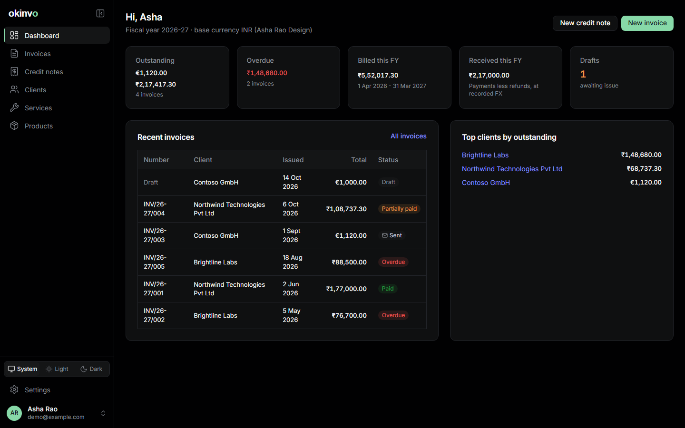
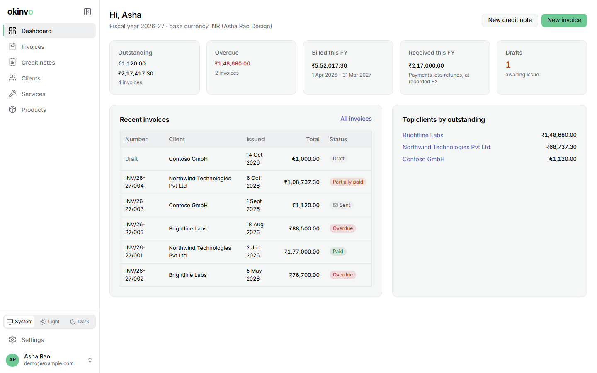

# okinvo documentation

okinvo is a self-hosted invoicing application for an independent professional or a small
business: issuer profiles, clients, a catalogue of services and products, immutable numbered
invoices with PDF, DOCX and QR verification, a payments ledger, credit notes, e-mail sending,
share links, exports and an API with an MCP server. It runs on your own Docker host or
Kubernetes cluster and never calls home.

## Start here

1. [Getting started](getting-started.md): install with Docker Compose, sign in, first steps.
2. [First-run wizard](onboarding.md): what the wizard asks and why.
3. [Issuer profiles](profiles.md): the party that issues your documents.
4. [Clients](clients.md), [Services and products](catalogue.md).
5. [Invoices](invoices.md): build, preview, issue, send.
6. [Payments](payments.md) and [Credit notes](credit-notes.md).

## Everything else

| Topic | Page |
| --- | --- |
| Look of the documents, fonts, header bands | [Templates and fonts](templates-and-fonts.md) |
| Share links, password-protected copies, verification | [Sharing and protected PDFs](sharing-and-protected-pdfs.md) |
| CSV, XLSX, the accountant hand-off, backups | [Exports and backups](exports-and-backups.md) |
| Every settings tab | [Settings reference](settings.md) |
| Owners, editors, viewers, invitations | [Roles and members](roles-and-members.md) |
| REST API, OpenAPI, the TypeScript SDK | [API and SDK](api-and-sdk.md) |
| Connecting Claude or any MCP client | [MCP and skills](mcp-and-skills.md) |
| India GST e-invoicing, EN 16931, Factur-X | [E-invoicing](e-invoicing.md) |
| 115 languages, translated documents | [Localisation](localisation.md) |
| What protects your data | [Security](security.md) |
| Running it with Docker Compose | [Operations: Compose](operations-compose.md) |
| Running it on Kubernetes | [Operations: Kubernetes](operations-kubernetes.md) |
| Short answers | [FAQ](faq.md) |

The same pages live in the repository under `docs/wiki/`, so they read fine on GitHub without
this site. Screenshots are generated from a seeded demo instance in both themes
(`pnpm docs:screenshots`), so they match the shipped UI.
