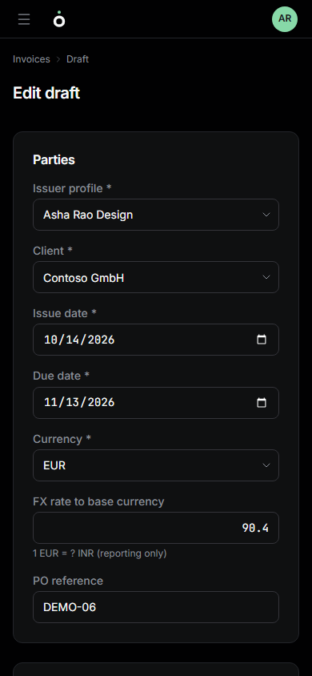
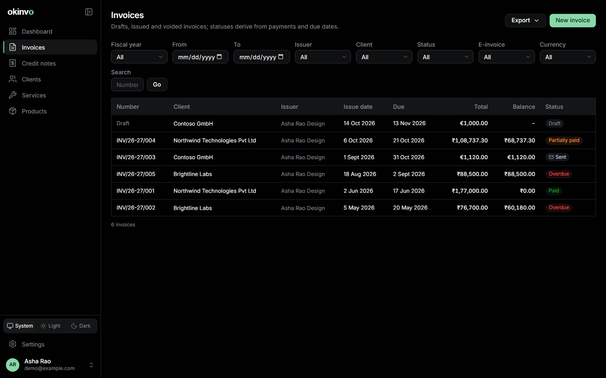
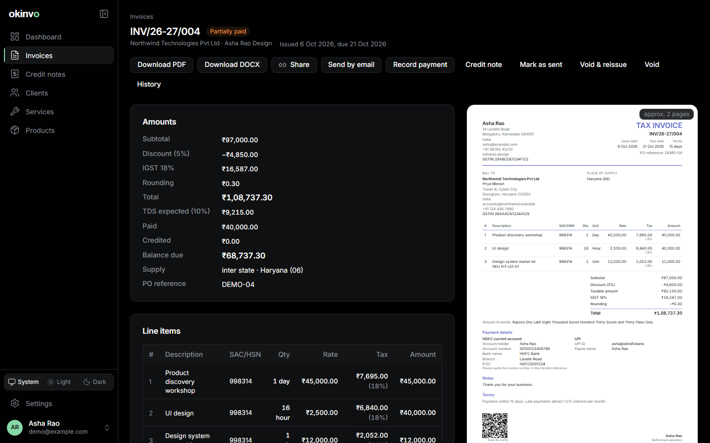
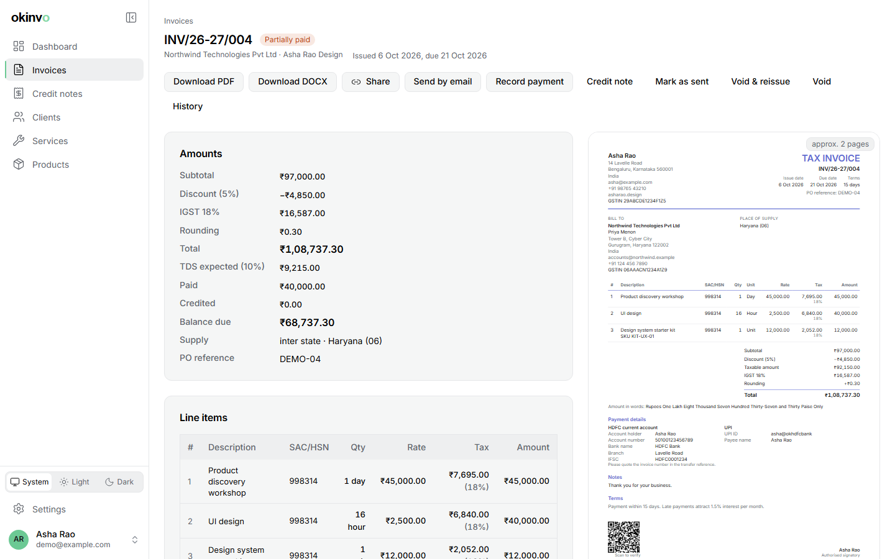
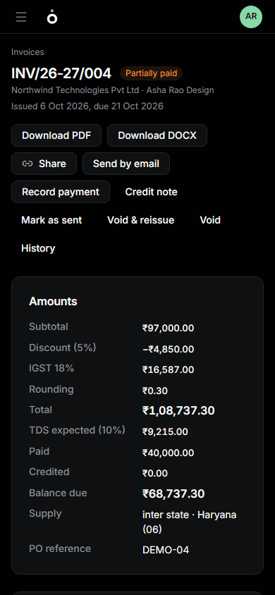
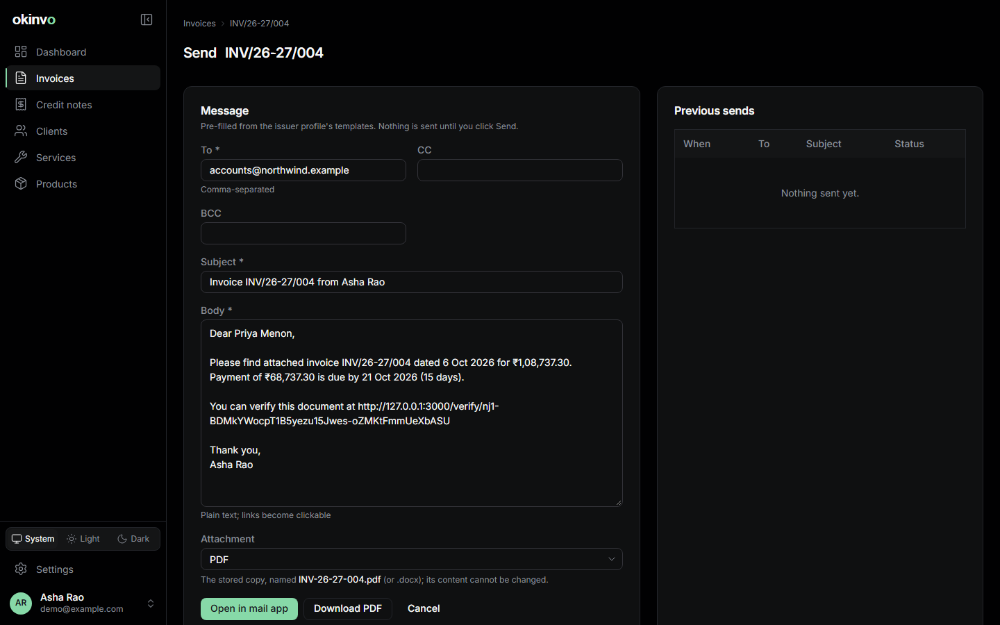

# Invoices

## The builder


Invoices > New invoice opens a split screen: the form on the left, the live preview on the
right. The preview is the same renderer as the PDF, so what you see is what will be issued,
including an approximate page count.

Work down the form:

1. **Issuer** and **client**. The client prefills the currency, the tax regime, the payment
   terms (due date) and the expected TDS rate.
2. **Lines**: from the catalogue or ad hoc. Description, SAC/HSN, unit, quantity (three
   decimals), rate, tax rate. Reorder with the arrows.
3. **Discount**: a fixed amount or a percentage of the subtotal, apportioned across the lines
   for per-line tax.
4. **Tax settings**: the regime and, for India, reverse charge; for exports, the LUT applies
   automatically when the profile holds a valid one for the fiscal year.
5. **Expected TDS**: informational, so the client knows the net to remit.
6. **Payment methods** and their print order.
7. **Display config**: which issuer fields, client fields, columns and sections print.
8. PO reference, notes, terms, and the document language.

Save a **draft** to come back later, or **Save and issue**.



## Amounts

Line and total amounts are rounded half-up to the currency's minor units (two for INR, USD, GBP
and EUR, none for JPY and KRW). Tax is computed per line and per component (CGST and SGST
separately), each rounded, then summed, so the printed table always foots. The optional rounding
adjustment brings the total to a whole unit without re-rounding tax.

```
subtotal       = sum of round(quantity x unit price)
taxable        = subtotal - discount
total          = taxable + tax + rounding adjustment
balance due    = total - payments - credit notes
```

## Lifecycle

```
DRAFT  --issue-->  ISSUED  --void-->  VOID
  |                  |
  delete             void and reissue --> a new linked DRAFT
```

- A **draft** is fully editable, has no number, and can be deleted. Its PDF preview carries a
  "DRAFT" watermark and no QR.
- **Issue** allocates the number, snapshots the issuer, client and payment methods, renders and
  stores the PDF with its hash, and freezes everything. Afterwards only the sent flag, payments,
  credit notes, e-invoice registration and void can change.
- **Void** needs a reason and is allowed only while no payment is recorded; otherwise raise a
  credit note. The number stays in the register.
- **Void and reissue** voids the original and opens a new draft with the same content, linked
  both ways; the new document can print "Replaces INV/...".

## Statuses

The status is derived, never stored: Draft, Void, Paid (balance is zero), Overdue (balance left
and the due date has passed), Partially paid, Sent, Issued. "Mark as sent" sets the sent flag by
hand; the first successful e-mail sets it too.



The register filters by fiscal year or dates, issuer, client, status, currency and e-invoice
registration, searches by number or client, and exports with the current filters.

## The invoice page



Everything about one document: the preview, the ledger summary, and the actions. Download PDF,
DOCX or a password-protected copy; send by e-mail; share; record a payment; raise a credit note;
void; the history page lists every e-mail, document version and audit event.





## Sending by e-mail



**Send by email** opens a composer prefilled from the issuer profile's templates, with the
client's address, the default CC and BCC, and the stored PDF or DOCX attached. Nothing is sent
until you click Send; every attempt is logged on the document's history and under Settings >
Email. Without SMTP the composer offers "Open in mail app" and "Mark as sent" instead.

Related: [Payments](payments.md), [Credit notes](credit-notes.md),
[Sharing](sharing-and-protected-pdfs.md), [E-invoicing](e-invoicing.md).
