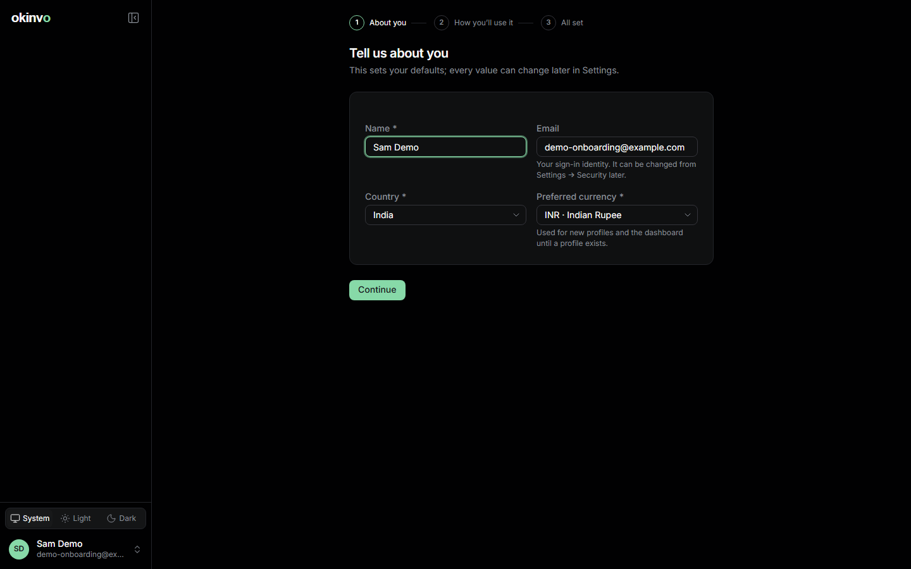
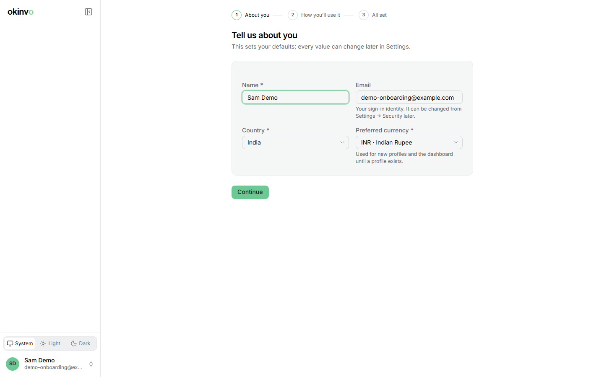

# First-run wizard

Every new account goes through a short wizard before it reaches the app. It cannot be skipped,
but every step saves as you go, so a reload resumes where you were.

## Step 1: Tell us about you

- **Photo** (optional): uploaded images are cropped to a circle and re-encoded.
- **Name**: shown in the sidebar, on the dashboard greeting and in the audit log.
- **Email**: read-only. It is your sign-in identity.
- **Country**: preselected from your browser's timezone and language, India otherwise.
- **Preferred currency**: preselected from the country (INR, GBP, USD); the full ISO 4217 list
  is available.

## Step 2: How will you use okinvo?

Two cards, *Personal invoicing* and *Business invoicing*. They only change the wording of the
prefilled profile. Below them, India asks "Do you have a GSTIN?" and checks the number's format
and check digit; the United Kingdom asks for a VAT number; the United States asks nothing.

## Step 3: You're set

A summary and one button, **Go to profiles**. It marks the account as onboarded and opens the
issuer profile form with the label, legal name, e-mail, country, base currency, locale and tax
id already filled from your answers. Saving that profile is the last step: from then on the
dashboard greets you by first name.

## Changing the answers later

Country, currency and language live under Settings > Account (the **Region** and **Language**
cards). They are defaults for new issuer profiles and for the dashboard when no profile exists.
The tax id belongs to the issuer profile.

Related: [Getting started](getting-started.md), [Issuer profiles](profiles.md),
[Settings](settings.md#account).
