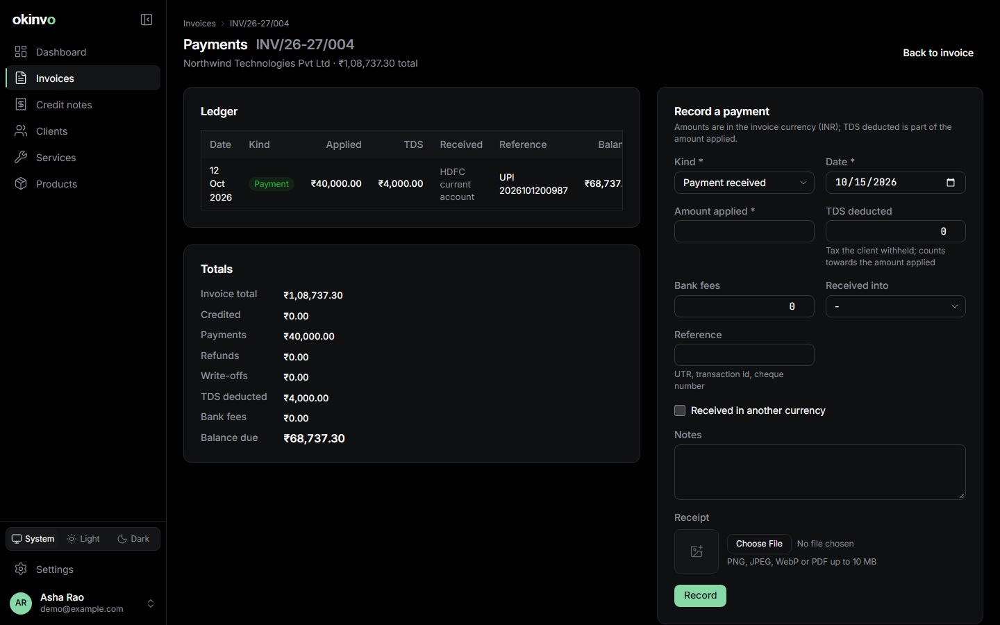

# Payments

Only issued invoices accept payments. Every entry recomputes the invoice balance in the same
transaction and is audited.

## Recording a payment

From the invoice page, **Record payment**:

- **Kind**: payment, refund (a negative amount) or write-off.
- **Date** (not before the issue date) and **amount applied** in the invoice currency.
- **TDS deducted**: the part of the applied amount the client withheld (India, Form 26AS).
- **Received amount**, currency and exchange rate: what actually landed in the bank, when it
  differs from the invoice currency.
- **Bank fees**, the receiving payment method, a reference, notes and a receipt upload.

The cumulative applied amount may not exceed the outstanding balance, except through an explicit
write-off, which is itself capped at the balance.

## The ledger

Running balance after each entry, totals by kind, TDS total and bank fees. Entries can be edited
or deleted while the invoice is issued; the balance follows.

## Statuses

Paid when the balance reaches zero. Overdue when a balance remains after the due date, even
after a partial payment. Partially paid otherwise.

## Reporting

The payments ledger dataset (Settings > Data or the Invoices register's export) lists every
entry with its TDS, received amount, exchange rate and fees; the TDS summary groups expected and
actually deducted TDS per client and fiscal year. See [Exports](exports-and-backups.md).

Related: [Invoices](invoices.md), [Credit notes](credit-notes.md).
