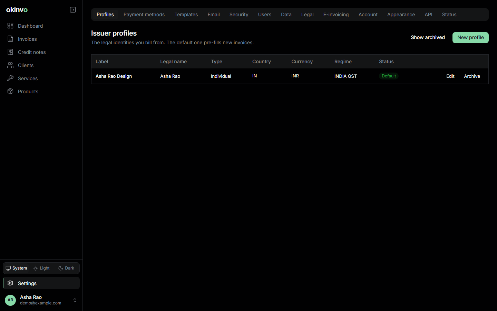
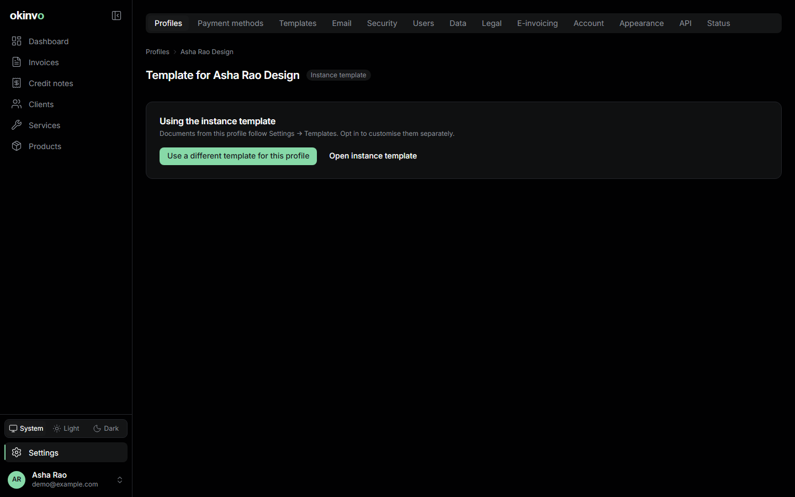

# Issuer profiles

An issuer profile is the party at the top of a document: you as an individual, your company, or
both as two profiles. At least one profile must exist before an invoice can be created; the first
one becomes the default, and exactly one non-archived profile is default at any time.

## Fields

| Group | What goes in |
| --- | --- |
| Identity | Type (individual or company), label (internal name), legal name, trade name, designation, e-mail, phone, website |
| Address | Line 1 and 2, city, state, postal code, country, state code and the two-digit GST state code (India) |
| Tax ids | PAN, GSTIN, CIN, UK VAT number, US EIN or SSN, LUT number with its financial year. Stored encrypted. |
| Defaults | Base currency, locale for document formatting (`en-IN`, `en-GB`, ...), fiscal-year start month, number formats, default tax regime, default expected TDS rate, default display config, default notes and terms |
| E-mail | Default CC and BCC, subject and body templates for invoices and credit notes |
| Template | An optional override of the instance-wide document template |
| Assets | Logo, signature and stamp (transparent PNGs), embedded at print resolution |

## Numbering

Numbers are allocated when a document is issued, per profile, per document kind, per fiscal
year, and are strictly consecutive. Drafts never consume a number, a failed issue leaves no gap,
and a voided number is never reused.

Formats use tokens: `{FY}` (`26-27`), `{FYYYY}` (`2026-27`), `{YYYY}`, `{YY}`, `{MM}`, `{SEQ}`
and `{SEQ:n}` (zero-padded to `n` digits). The defaults are `INV/{FY}/{SEQ:3}` and
`CN/{FY}/{SEQ:3}`. A format must contain a year token. Changing it affects only future numbers.

## Archiving

A profile with issued documents cannot be deleted. Archive it instead: it disappears from the
pickers and its documents stay exactly as issued. Unarchive at any time.

## Per-profile template

Settings > Profiles > *profile* > Template opens the same editor as Settings > Templates, but the
result applies to that profile only. See [Templates and fonts](templates-and-fonts.md).

## E-invoicing settings

The GST e-invoice connector and the EU profile (EN 16931) are set per issuer profile under
Settings > E-invoicing. See [E-invoicing](e-invoicing.md).

Related: [Payment methods](settings.md#payment-methods), [Clients](clients.md).
