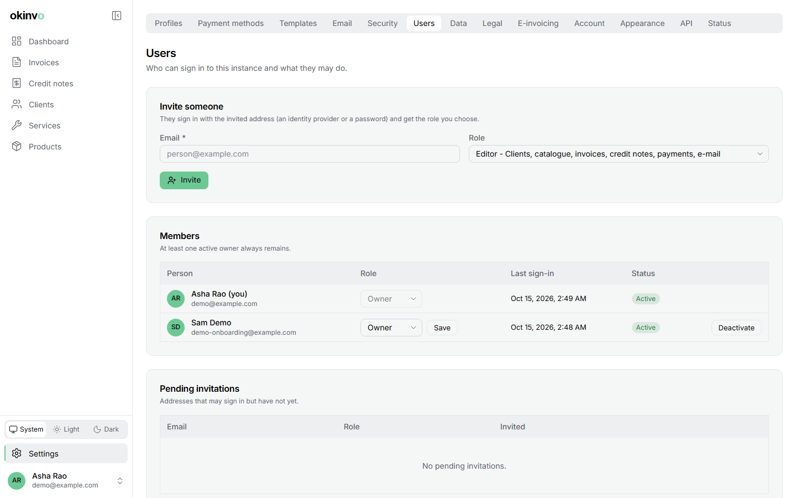

# Roles and members

## Roles

| Role | Can |
| --- | --- |
| **Owner** | Everything: settings, members, templates, legal and e-invoicing configuration, all exports |
| **Editor** | Clients, catalogue, invoices, credit notes, payments, e-mail sending, share links, exports of those datasets; their own account only |
| **Viewer** | Read-only: registers, documents, dashboard, exports of what they can read |

The first account is an owner, and at least one active owner must always remain: the app
refuses the last demotion or deactivation. Navigation hides what a role cannot do, and the
server enforces the role on every action and API call, so hiding is a courtesy, not the
boundary.

## Inviting someone

Settings > Users > **Invite**: an e-mail address and a role. The address is admitted on its next
sign-in with that role, whatever the environment allow-list says. When SMTP is configured an
invitation e-mail carries the sign-in link; otherwise the link is shown to copy. The
environment list `AUTH_ALLOWED_EMAILS` keeps working as the bootstrap list and admits owners.

## Changing a role, deactivating

Role changes apply at once, including to the member's API keys, whose effective scopes are
capped by the member's current role. Deactivation ends every session, refuses sign-in, revokes
the member's API keys and keeps their rows for the audit trail; reactivation restores access.

## Audit

Invitations, role changes, deactivations and reactivations are audited, and every audit event
records the actor's role at the time.

Related: [Settings](settings.md#users), [Security](security.md).
