# Settings reference

Settings is a row of tabs. Owners see all of them; editors and viewers see Account, Appearance,
API and Status.

## Profiles

Issuer profiles: create, edit, archive, set the default, per-profile template. See
[Issuer profiles](profiles.md).

## Payment methods

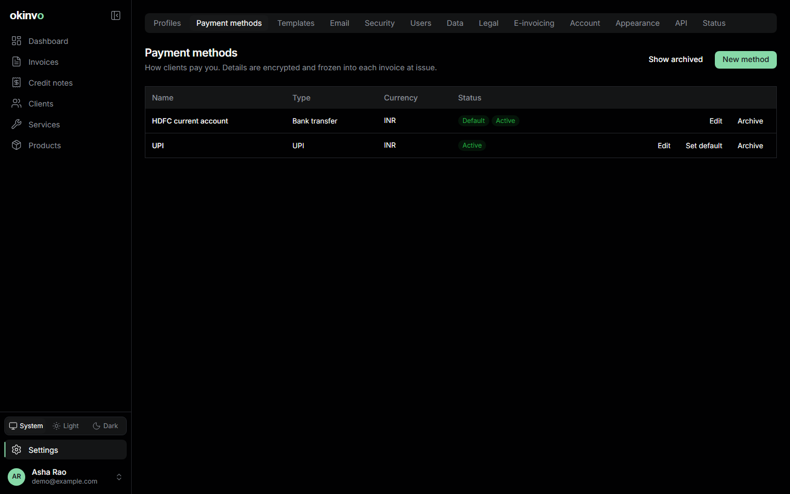

Bank transfer (account holder, number, bank, branch, IFSC, SWIFT/BIC, IBAN, routing or sort
code), UPI (VPA and payee), Wise, Revolut, PayPal, or custom lines. Each has a name, an optional
currency, display instructions, an active flag and an optional default. Details are encrypted at
rest and snapshotted into each invoice at issue, so edits never change an issued document.

## Templates

The active document template and its customisation with a live preview, reset, export and
import. See [Templates and fonts](templates-and-fonts.md).

## Email

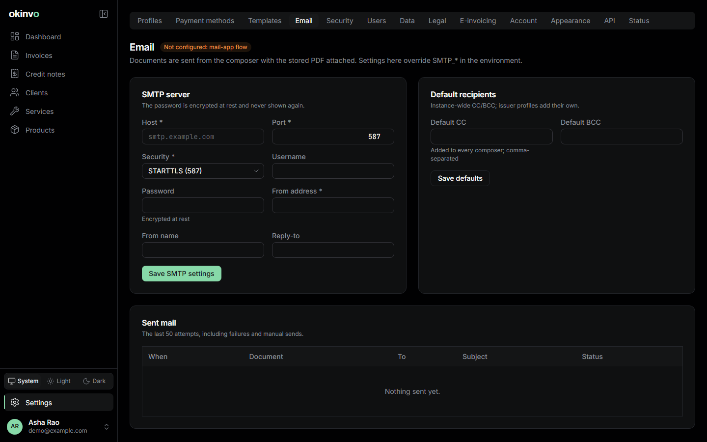

SMTP host, port, security (STARTTLS, TLS or none), user, password (encrypted), from address and
name, reply-to; or the values from the environment, which the page names as the active source.
**Send test email** delivers a message to you. The sent-mail log lists every attempt with its
status and error.

## Security

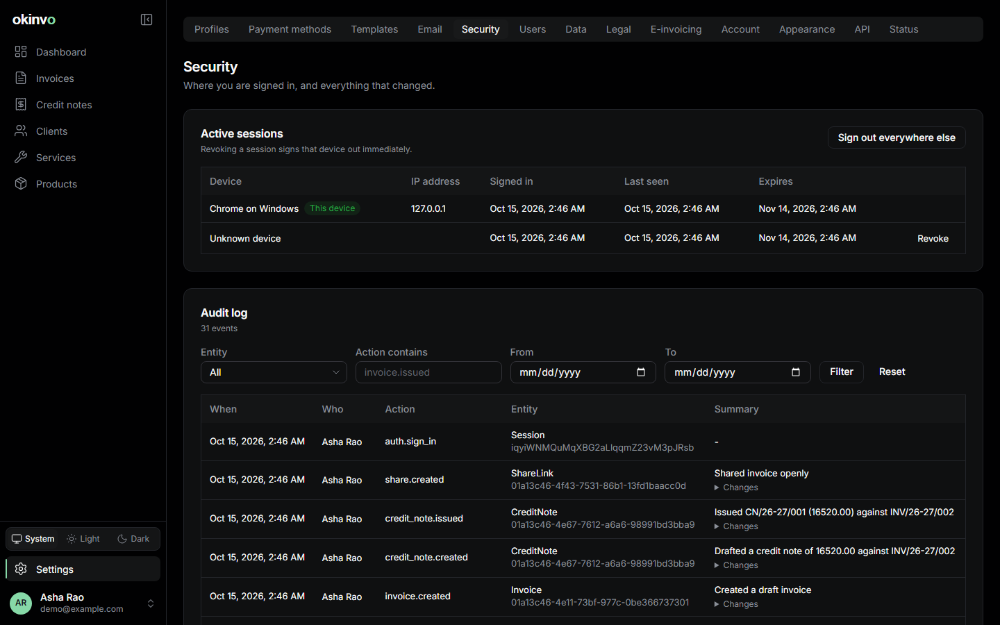

Active sessions (device, address, last seen) with per-session revocation and "sign out
everywhere", and the audit log viewer filtered by entity, action and date.

## Users

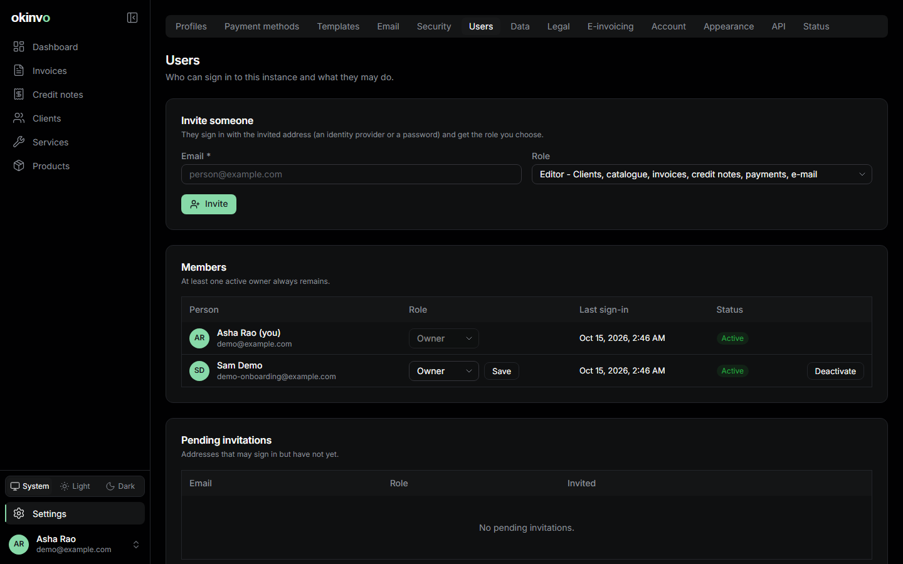

Members with their role, last sign-in and status; invite by e-mail with a role; change roles;
deactivate and reactivate. See [Roles and members](roles-and-members.md).

## Data

Export all data, export documents, backup status. See
[Exports and backups](exports-and-backups.md).

## Legal

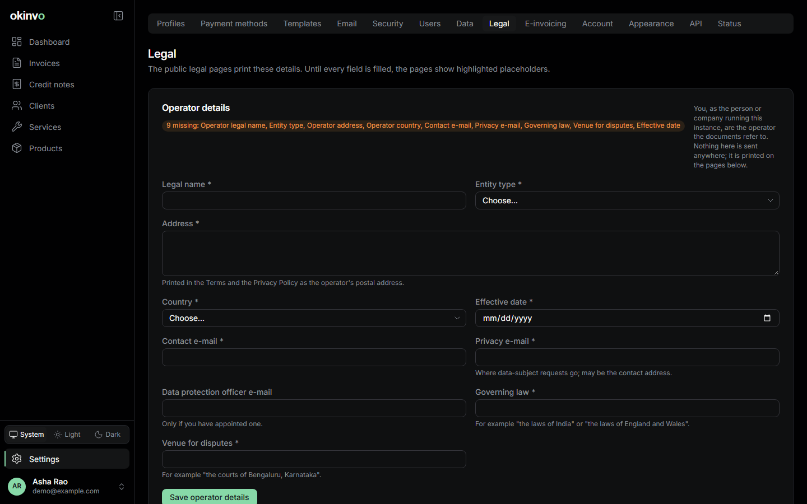

The operator's details (legal name, address, contact and privacy e-mails, governing law, data
protection contact) that fill the public pages under `/legal/*`: terms, acceptable use, privacy
policy, cookie policy, retention schedule, security page and licences. Unset fields render as
highlighted placeholders and the page warns until they are filled.

## E-invoicing

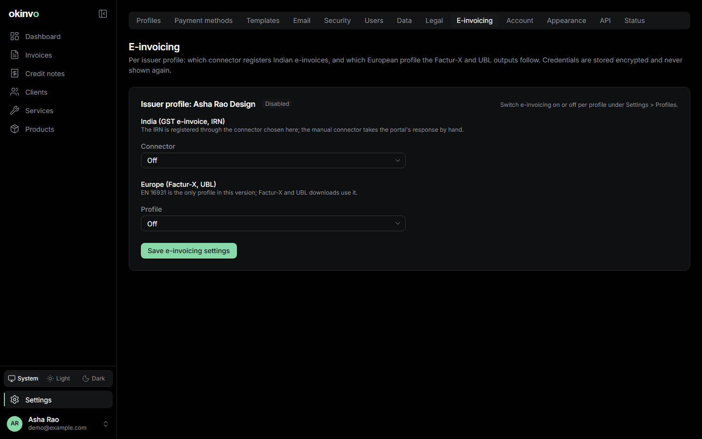

Per issuer profile: enable GST e-invoicing, choose the connector (manual or NIC with its
credentials, encrypted), and the EU profile (none or EN 16931). See
[E-invoicing](e-invoicing.md).

## Account

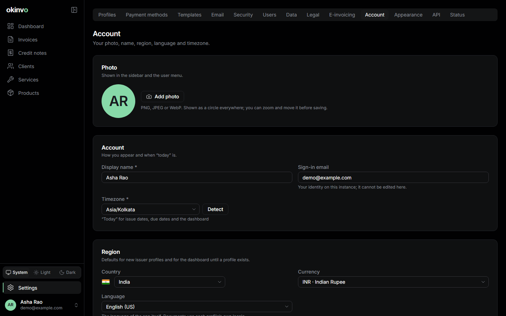

Photo and name, the sign-in e-mail, region (country and currency), language, timezone, and the
privacy card listing the cookies the app sets with "show the notice again". "Today" everywhere
in the app is computed in your timezone.

## Appearance

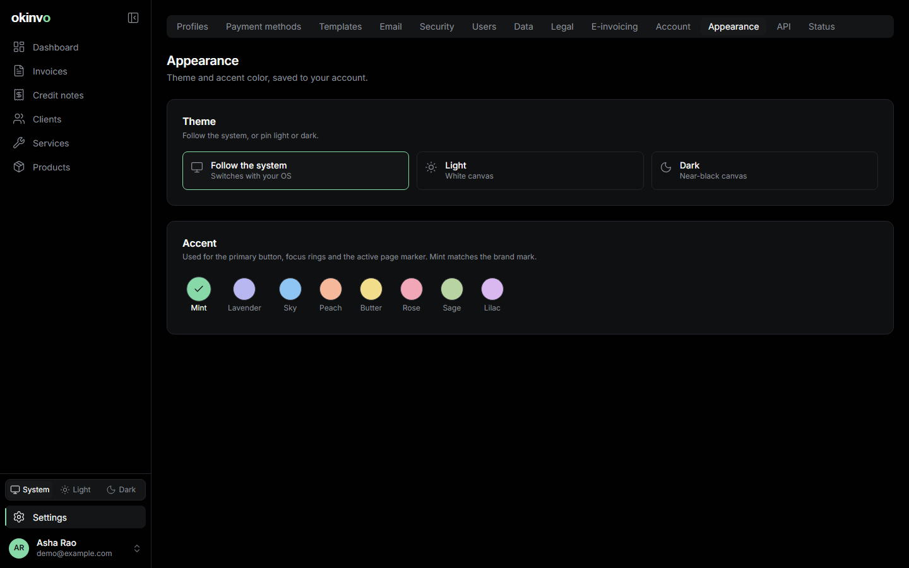

Theme (system, light, dark) and one of eight pastel accents (mint by default). The sidebar
footer carries the same theme switch.

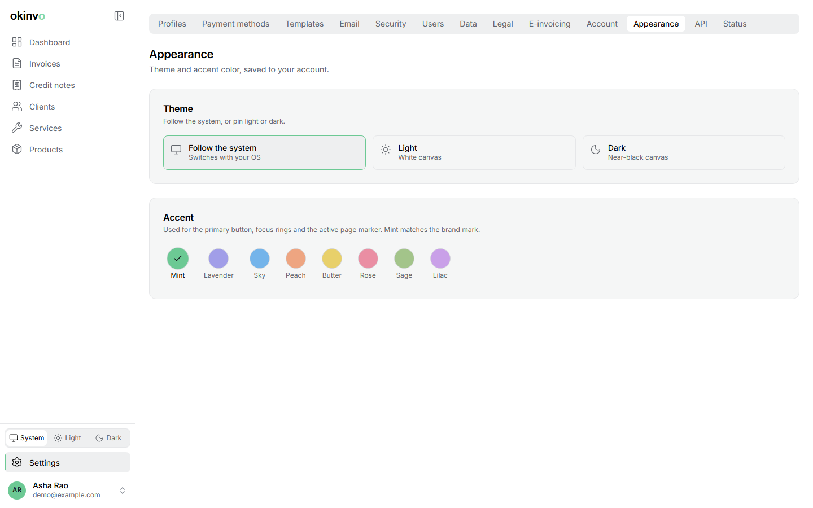

## API

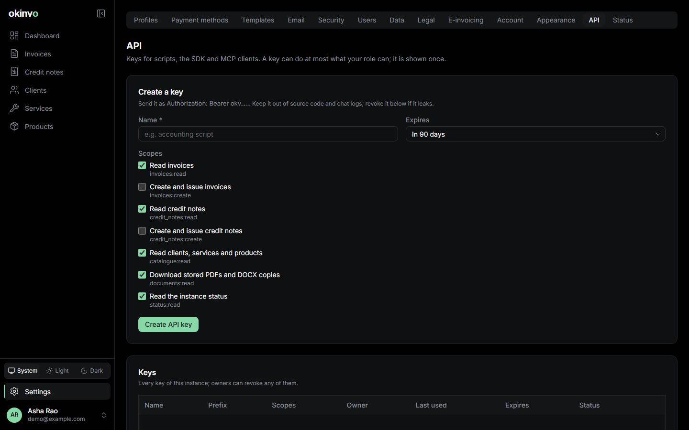

API keys: name, scopes, expiry; the key is shown once. See [API and SDK](api-and-sdk.md).

## Status

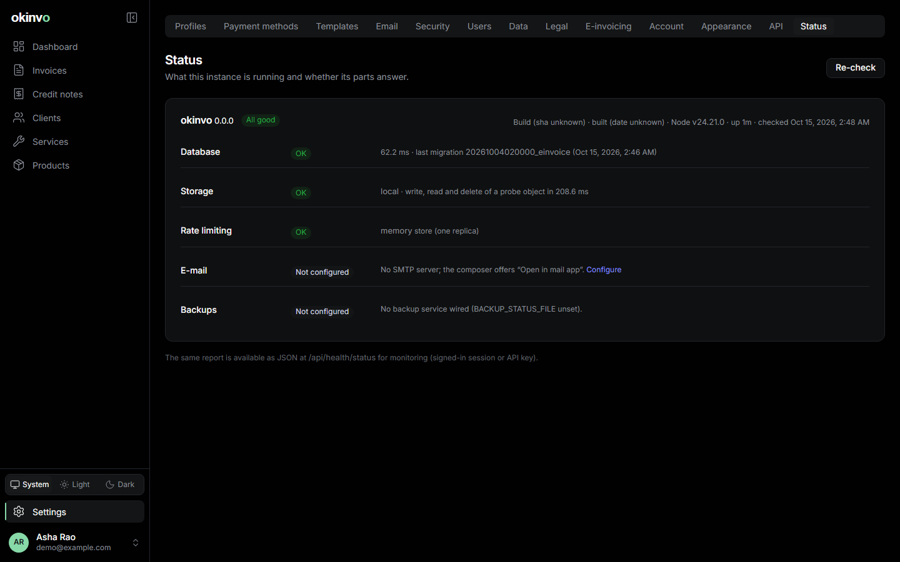

Version and build provenance, uptime, database latency and last migration, a storage probe,
the rate-limit store, SMTP configuration and last test, backup freshness and the last 24 hours of
e-mail. Each row is OK, warning or failed; `GET /api/health/status` returns the same as JSON.
