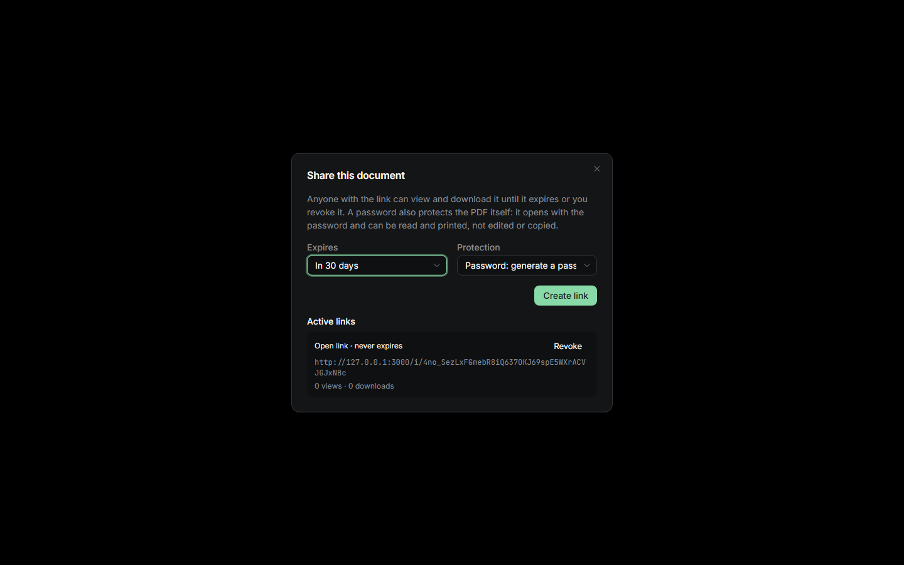
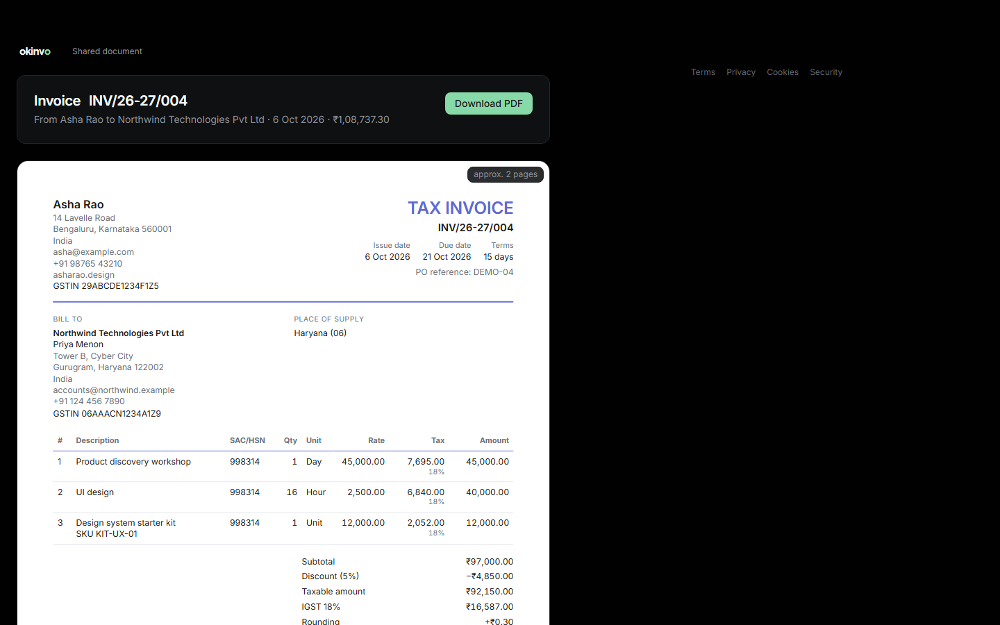

# Sharing and protected PDFs

## Share links

**Share** on an issued (or voided) invoice or credit note creates a public link `/i/<token>`.
Options:

- **Protection**: open, a generated six-word passphrase, or your own password. A protected
  link renders its own password-protected copy of the document when created and only ever
  serves that copy; the canonical PDF is never reachable through it.
- **Expiry**: 7, 30 or 90 days, or never.

The dialog shows the link and, for a protected one, the passphrase to pass on separately. Links
can be revoked at any time and count views and downloads. Unknown, revoked and expired links all
answer the same way, and password guesses are limited per link and address.

The viewer shows the document facts (issuer, client, number, date, total, void status), the
same preview the app uses, and a download. It never shows payment status.

## Password-protected copies

A protected copy is a separate stored version of the document (`-protected` in the filename),
rendered from the same snapshot and AES-256 encrypted. It opens with the recipient's password and
can be read and printed at full quality, but text cannot be copied and the file cannot be
edited, annotated or re-assembled. The passphrase generator uses the EFF short word list; a
manual password gets a strength hint. Every copy is audited, never with the password, and the
canonical PDF's bytes and hash are unaffected.

## Verification

Every document prints a QR code pointing at `/verify/<token>`. The public page shows the kind
and number, the issuer's legal name (and GSTIN if printed), the client, the date, currency and
total, and whether the document is valid or void, never the payment status. It lists the SHA-256
of every stored version, with a "check your copy" control that hashes a file in the browser and
compares it, nothing uploaded. Drafts never resolve.

Related: [Invoices](invoices.md), [Security](security.md).
