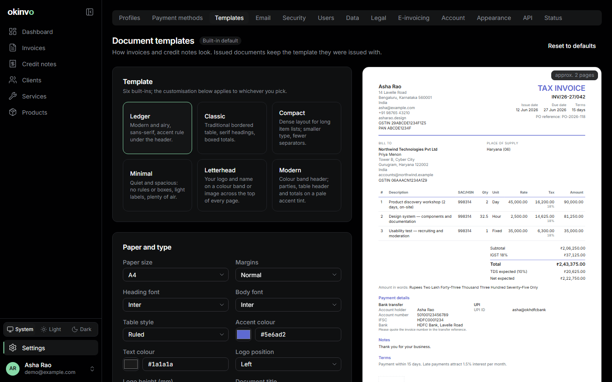
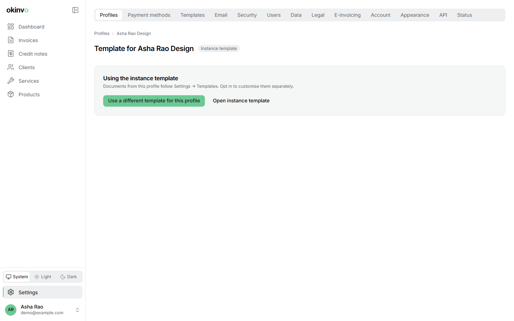

# Templates and fonts

The look of every document is decided in Settings > Templates, never on the invoice form. The
builder's display config decides *what* prints; the template decides *how*.

## Six templates

| Template | Character |
| --- | --- |
| Ledger | Modern and airy, sans-serif, an accent rule under the header |
| Classic | Bordered table, serif headings, boxed totals |
| Compact | Dense, for long item lists |
| Minimal | Quiet and spacious, light labels, no rules |
| Letterhead | Logo and name on a full-width colour band or image on every page |
| Modern | Colour band header; parties, table header and totals on a pale accent tint |

## Customisation

Edited with a live preview on sample data and applied to invoices and credit notes alike:

- Paper size (A4 or Letter) and margins (normal or narrow).
- Accent colour, text colour, table style (ruled, zebra, plain).
- **Heading font and body font**, each from a catalogue of 100 Google families (50 sans, 50
  serif) vendored into the app, so no font is fetched at runtime.
- Logo position and height.
- **Header**: none, a colour band, or an uploaded image (PNG, JPEG or WebP, stored as PNG) with
  opacity and height. The band or image repeats on every page and carries the logo, name, title
  and number; text on it is light or dark automatically.
- Document title: `TAX INVOICE`, `INVOICE`, `BILL OF SUPPLY` or custom text, with a
  GST-appropriate default.
- Label overrides for the fixed strings ("Bill to", "Amount due", ...).
- Which totals rows print and where the amount in words sits.
- Header note, footer text, signature caption, page numbers, QR position, draft watermark.
- Reset to defaults; export and import the configuration as JSON.

Templates are parameters only: no custom HTML, CSS or uploaded fonts.

## Scope and immutability

One active configuration applies to the whole instance; an issuer profile may opt into its own
override (Settings > Profiles > Template). The effective configuration is snapshotted into each
document at issue, so later changes affect only future documents, and regenerated versions
render from the snapshot.

## Page layout

Documents fit A4 and Letter: the items table repeats its header row on every page, the totals
block never splits across pages, section titles are never left alone at the foot of a page, and
a footer band carries the number and "Page n of N".

## Non-Latin scripts

A document in another language prints its labels from the matching Noto Sans family, run by
run, next to the Latin template fonts. See [Localisation](localisation.md).

Related: [Invoices](invoices.md), [Settings](settings.md#templates).
